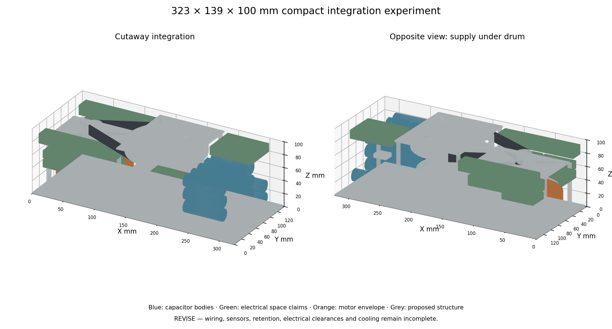

# Compact integration experiment

Fingerprint: `d4c5c340e2eac1b453716af7a582d02686461b3e86a82d7bed4249f6d1937707`

**REVISE. This is an integration experiment, not a qualified compact assembly.** It rotates the shafts vertically, stacks the supply below the drum, uses a top-supported dead shaft and reserves an end bay for the compact capacitor alternative. The verified coupled reference still uses the large bank; this alternative is not silently substituted.

Body target: [323, 139, 100] mm. Parts: 64. Out of bounds: none. Solid overlaps: 0.

CAD drum + wheel aluminium inertia: 0.000397079 kg m², versus 0.0003 in the coupled reference. Rope winding and bearing rotating masses are additional; this mismatch must be reconciled before calling the CAD and simulation one design.

Motor adapter + spindle + pinion add 0.000133693 kg m² at motor speed. Total known reflected inertia including the catalog rotor is 0.024254 kg m². This uses assumed aluminium/steel densities of 2700/7850 kg/m³. Carrier inertia is additional to the bare motor rotor and must not be omitted.

Open-belt geometric length: 460.12 mm; pinion wrap 130.9°. No stock belt, tooth load rating, fatigue life or tensioner range is qualified.

## Collision evidence

| Part A | Part B | Overlap mm³ |
|---|---|---:|

### rope_path

No listed solid intersection; clearances/contact design remain unqualified.

### guide_sweep

No listed solid intersection; clearances/contact design remain unqualified.

## Fidelity

| Part | Evidence/detail |
|---|---|
| base | Proposed structural base; mounting joints unqualified |
| enclosure_skin | 2 mm skin with inlet and moving-rope slots; sealing and attachment unresolved |
| motor_pedestal | Carrier interface and rotor/stator attachment unresolved |
| motor_envelope | Sourced outer envelope only; internal rotor/stator geometry absent |
| motor_rotor_adapter | Proposed rotating carrier; actual motor mating geometry unresolved |
| motor_spindle | Proposed 10 mm spindle and positive-drive interface unresolved |
| motor_bearing_0 | NSK 6000 boundary envelope; ball/race detail omitted |
| motor_bearing_1 | NSK 6000 boundary envelope; ball/race detail omitted |
| motor_bearing_housing | Bearing seat/retention not detailed |
| motor_carrier_bridge | Connected load path proposal; plate and joint checks open |
| motor_post_0 | Proposed stationary post; fasteners omitted |
| motor_post_1 | Proposed stationary post; fasteners omitted |
| motor_post_2 | Proposed stationary post; fasteners omitted |
| motor_post_3 | Proposed stationary post; fasteners omitted |
| drum | Hollow core and flanges match winding width; 2 mm flanges need load/fatigue review |
| wound_rope_envelope | Occupied winding space only; crossovers and actual helical rope geometry absent |
| drum_bearing_0 | NSK 6005 envelope; shaft stationary and outer race rotates with drum |
| drum_bearing_1 | NSK 6005 envelope; shaft stationary and outer race rotates with drum |
| drum_dead_shaft | Top-supported 25 mm dead shaft; retention and cantilever joint unresolved |
| drum_top_bridge | Connected to shaft/post proposal; 2 mm thickness unqualified |
| drum_post_0 | Proposed shaft-support post and fasteners |
| drum_post_1 | Proposed shaft-support post and fasteners |
| drum_post_2 | Proposed shaft-support post and fasteners |
| drum_post_3 | Proposed shaft-support post and fasteners |
| driven_wheel | 120-tooth 3 mm pitch envelope and lightweight web; tooth geometry/rating absent |
| pinion | 20-tooth 3 mm pitch envelope; bore fits spindle; rating/key unresolved |
| belt_span_-1 | Straight belt envelope only; wrap arcs omitted |
| belt_span_1 | Straight belt envelope only; wrap arcs omitted |
| supply_envelope | Sourced EPP-500 envelope; mains terminals, underside clearance and 25 CFM ducting not established |
| supply_partition_claim | Illustrative barrier only; NOT rated isolation clearance |
| capacitor_00 | Eaton maximum body envelope; lead bend, insulation and balance/protection boards additional |
| capacitor_01 | Eaton maximum body envelope; lead bend, insulation and balance/protection boards additional |
| capacitor_02 | Eaton maximum body envelope; lead bend, insulation and balance/protection boards additional |
| capacitor_03 | Eaton maximum body envelope; lead bend, insulation and balance/protection boards additional |
| capacitor_04 | Eaton maximum body envelope; lead bend, insulation and balance/protection boards additional |
| capacitor_05 | Eaton maximum body envelope; lead bend, insulation and balance/protection boards additional |
| capacitor_06 | Eaton maximum body envelope; lead bend, insulation and balance/protection boards additional |
| capacitor_07 | Eaton maximum body envelope; lead bend, insulation and balance/protection boards additional |
| capacitor_08 | Eaton maximum body envelope; lead bend, insulation and balance/protection boards additional |
| capacitor_09 | Eaton maximum body envelope; lead bend, insulation and balance/protection boards additional |
| capacitor_10 | Eaton maximum body envelope; lead bend, insulation and balance/protection boards additional |
| capacitor_11 | Eaton maximum body envelope; lead bend, insulation and balance/protection boards additional |
| capacitor_12 | Eaton maximum body envelope; lead bend, insulation and balance/protection boards additional |
| capacitor_13 | Eaton maximum body envelope; lead bend, insulation and balance/protection boards additional |
| capacitor_14 | Eaton maximum body envelope; lead bend, insulation and balance/protection boards additional |
| capacitor_15 | Eaton maximum body envelope; lead bend, insulation and balance/protection boards additional |
| capacitor_16 | Eaton maximum body envelope; lead bend, insulation and balance/protection boards additional |
| capacitor_17 | Eaton maximum body envelope; lead bend, insulation and balance/protection boards additional |
| capacitor_18 | Eaton maximum body envelope; lead bend, insulation and balance/protection boards additional |
| capacitor_19 | Eaton maximum body envelope; lead bend, insulation and balance/protection boards additional |
| capacitor_20 | Eaton maximum body envelope; lead bend, insulation and balance/protection boards additional |
| capacitor_21 | Eaton maximum body envelope; lead bend, insulation and balance/protection boards additional |
| application_controller | Unselected functional allocation; footprint/height and all electrical/thermal clearances require verification |
| independent_supervisor | Unselected functional allocation; footprint/height and all electrical/thermal clearances require verification |
| protection_and_balance | Unselected functional allocation; footprint/height and all electrical/thermal clearances require verification |
| fan_and_duct_claim | Unselected functional allocation; footprint/height and all electrical/thermal clearances require verification |
| dump_resistor_claim | Unselected functional allocation; footprint/height and all electrical/thermal clearances require verification |
| phase_brake_claim | Unselected functional allocation; footprint/height and all electrical/thermal clearances require verification |
| drive_board_claim | Unselected functional allocation; footprint/height and all electrical/thermal clearances require verification |
| mains_entry_and_filter | Unselected functional allocation; footprint/height and all electrical/thermal clearances require verification |
| auxiliary_power_claim | Unselected functional allocation; footprint/height and all electrical/thermal clearances require verification |
| transfer_and_bus_claim | Unselected functional allocation; footprint/height and all electrical/thermal clearances require verification |
| guide_screw | Proposed guide drive; actuator synchronization and wear unqualified |
| guide_carriage | Mid-travel only; entire 30 mm swept volume checked separately |

## Remaining requirements

- Bearing boundary dimensions are sourced; retention shoulders seals lubrication fits and life are unqualified.
- All electronics heights except the supply are unverified space claims. Functional allocations must be reconciled with actual circuit designs.
- Belt wheels are smooth pitch/envelope representations; teeth belt ratings tensioner and hubs need detailed design.
- Supply is stacked below the drum; a 1 mm partition claim is NOT an approved mains clearance or airflow allowance.
- Guide travel is 30 mm at 90 mm lead. Guide contact curvature friction wear and synchronization remain unresolved.

Required functions not yet represented by complete geometry: force transducer and overload path, stop actuator, mount retention and state sensing, external peer connector, encoder and winding sensor detail, positive shaft/bearing retention, connector bodies and pinouts, mains/DC insulation and airflow keepouts, wiring and formed capacitor leads.

Motor carrier → posts → base and drum → bearings → dead shaft → top bridge → posts → base are connected proposed load paths. Strength, joints, positive retention, board/adapter load transfer, electrical isolation, cooling and installation clearances remain unqualified. No bare overlap check establishes these properties.

Reproduce: `.venv/bin/python -m odrt.compact_package`. STEP: `build/cad/compact_integration.step`; GLBs: `compact_integration_full.glb` and `compact_integration_cutaway.glb` in the same directory.
