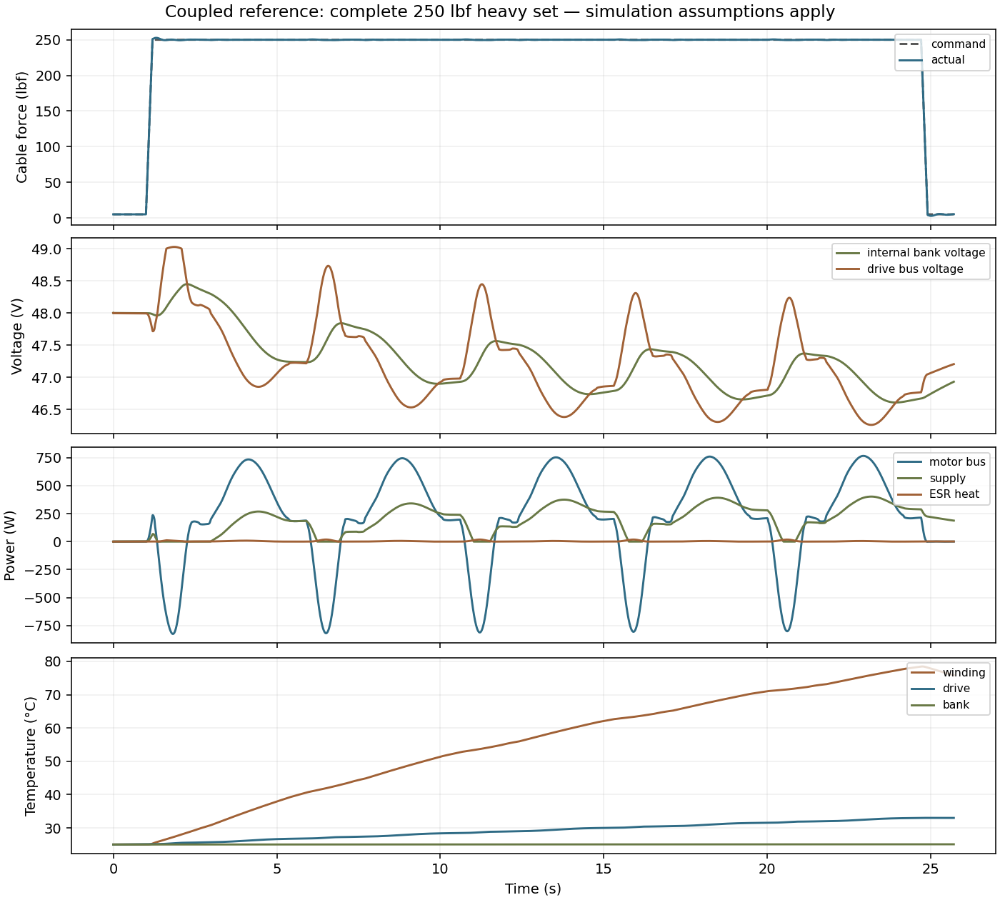
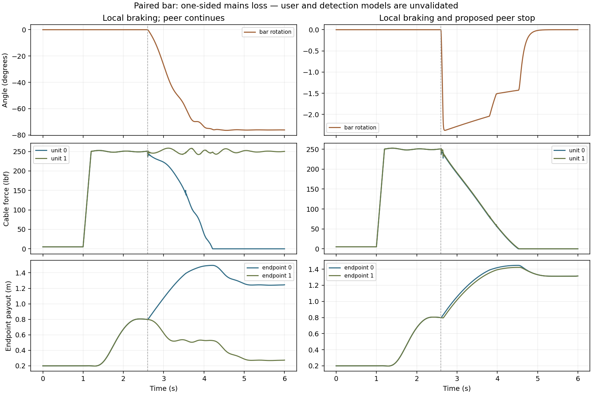
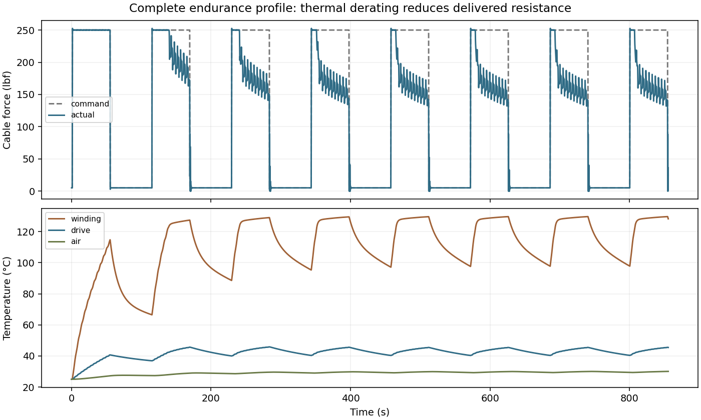

# Coupled open resistance-control reference

> Simulation only. This is a reusable electromechanical model with explicit limitations, not hardware or human-use qualification.

Input/model hash: `c85e334597b8e4cafd824b085e6ac257be4febdebdc7dd488ae8ced10d47bbea`

Case scope: **complete configured suite**; 27 of 27 configured cases. CasADi 3.8.2, NumPy 1.26.4.

## Physical and software contracts

Positive displacement is cable payout; positive motor torque resists payout. Each unit has separate supply, bulk capacitance, DC-link capacitance and ESR. A two-unit rigid bar has translation and rotation, so a one-sided fault can move the bar asymmetrically. Sensor filters, PI control, current/voltage saturation, thermal derating, regeneration, dump resistance, local braking and optional peer stops operate in one coupled ODE.

Motor, housing, drive, supply, capacitor bank, dump and enclosure air each have thermal storage. The energy ledger integrates user work and wall input against mechanical/elastic/electrical/thermal storage and heat leaving to the room. Neither negative gear losses nor a hidden voltage clamp is permitted.

The reference uses a RO100 Lite, 6:1 reduction, 30 mm core and a 6-turn, two-layer 5 mm rope drum. The bank is 22 series 350 F cells: 15.91 F and 0.0704 Ω initial ESR, not an ideal 2 F bank. A 3 mF separate DC-link state resolves capacitor-to-bus current and voltage drop. The EPP-500-48 candidate is modeled with required forced cooling and one-way output blocking.

Power-loss, stuck sensing, frozen/inverted commands, communication loss, release and dump failure are injected as named scenarios. Protective detection delays are assumptions; results compare policies and do not validate a detector or establish a safe release. Voltage and winding/drive/cell temperature crossings latch a unit off through solver zero-crossing events. A recovering bus cannot rearm it; a fresh simulation run initializes the latch. Where configured, the peer stops after the trip time plus the assumed peer delay. Event transitions reset only controller/discrete states, with no instantaneous change to stored physical energy.

## Case results

| Case | Duration s | Tracking RMS % (unit 0) | Worst tension lbf | Worst bus min / max V | Worst winding °C | Bar rotation ° | Energy residual fraction |
|---|---:|---:|---:|---|---:|---:|---:|
| single_curl_full | 302.6 | 0.46 | 40.7 | 47.85 / 48.22 | 28.9 | 0.00 | 6.11e-07 |
| single_row_full | 494.8 | 0.34 | 121.7 | 47.25 / 48.91 | 48.9 | 0.00 | 3.13e-07 |
| single_press_full | 458.8 | 0.45 | 152.1 | 46.90 / 49.02 | 55.5 | 0.00 | 3.02e-07 |
| single_slow_full | 512.6 | 0.08 | 201.8 | 46.97 / 48.17 | 96.2 | 0.00 | 1.15e-08 |
| single_eccentric_full | 359.6 | 0.14 | 150.6 | 47.37 / 48.44 | 56.4 | 0.00 | 1.16e-07 |
| single_heavy_full | 25.7 | 0.14 | 252.7 | 46.26 / 49.03 | 78.5 | 0.00 | 1.8e-07 |
| single_hold_full | 32.2 | 0.11 | 252.5 | 46.75 / 48.00 | 83.7 | 0.00 | 7.73e-10 |
| single_low_full | 124.4 | 3.38 | 8.7 | 47.93 / 48.05 | 25.8 | 0.00 | 4.09e-06 |
| single_fast_full | 18.2 | 40.25 | 517.2 | 46.12 / 49.05 | 51.3 | 0.00 | 3.41e-06 |
| single_stroke_full | 29.7 | 64.10 | 336.3 | 47.28 / 49.09 | 37.4 | 0.00 | 1.51e-07 |
| single_endurance_full | 855.6 | 28.51 | 252.6 | 45.97 / 49.01 | 129.7 | 0.00 | 6.87e-08 |
| paired_heavy_full | 25.7 | 0.23 | 252.7 | 46.26 / 49.03 | 78.3 | 0.00 | 3.82e-07 |
| paired_asymmetric | 25.7 | 2.00 | 261.9 | 45.09 / 49.03 | 77.9 | 23.51 | 2.28e-08 |
| left_power_loss_uncoordinated | 6.0 | 0.51 | 258.6 | 46.64 / 49.03 | 40.6 | 76.50 | 1.75e-07 |
| left_power_loss_coordinated | 6.0 | 0.51 | 252.7 | 47.71 / 49.03 | 31.1 | 2.38 | 5.33e-07 |
| left_power_loss_buffered | 6.0 | 0.51 | 252.7 | 46.02 / 49.03 | 40.9 | 0.00 | 1.98e-07 |
| left_power_loss_buffered_coordinated | 6.0 | 0.51 | 252.7 | 46.02 / 49.03 | 40.9 | 0.00 | 6.16e-07 |
| left_sensor_loss | 6.0 | 0.51 | 253.0 | 47.71 / 49.03 | 31.1 | 1.26 | 5.33e-07 |
| left_encoder_loss | 6.0 | 0.51 | 252.7 | 47.71 / 49.03 | 31.1 | 1.40 | 5.33e-07 |
| left_torque_inverted | 6.0 | 0.51 | 271.0 | 46.54 / 49.03 | 31.1 | 4.13 | 3.89e-07 |
| left_torque_frozen | 6.0 | 0.51 | 252.7 | 47.71 / 49.03 | 31.2 | 1.38 | 5.35e-07 |
| paired_communication_loss | 6.0 | 0.51 | 252.7 | 47.71 / 49.03 | 31.1 | 0.00 | 1.74e-07 |
| paired_release | 6.0 | 0.51 | 252.7 | 46.87 / 49.03 | 29.8 | 0.00 | 8.8e-07 |
| paired_release_asymmetric | 6.0 | 0.51 | 252.7 | 46.86 / 49.03 | 29.8 | 45.48 | 2.07e-07 |
| paired_emergency_stop | 6.0 | 0.51 | 252.7 | 47.71 / 49.03 | 31.0 | 0.00 | 1.71e-07 |
| paired_dump_failure | 6.0 | 0.17 | 252.7 | 46.82 / 49.41 | 40.9 | 0.00 | 3.34e-09 |
| paired_dump_failure_coordinated | 6.0 | 0.17 | 252.7 | 46.82 / 49.41 | 40.9 | 0.00 | 4.8e-07 |

## Latched protective events

Bus extrema in the case table are sampled values; a trip record locates the threshold crossing between samples. Hardware sensing delay, switching overshoot and reset authorization are not modeled.

| Case | Unit | Trip reason | Event time s |
|---|---:|---|---:|

## Explicit design-screen outcomes

These outcomes compare the model to documented or proposed criteria; none is human-use qualification.

| Case | Failed model/design criteria |
|---|---|
| single_curl_full | No listed screen failure; hardware and model limitations remain |
| single_row_full | No listed screen failure; hardware and model limitations remain |
| single_press_full | No listed screen failure; hardware and model limitations remain |
| single_slow_full | No listed screen failure; hardware and model limitations remain |
| single_eccentric_full | No listed screen failure; hardware and model limitations remain |
| single_heavy_full | No listed screen failure; hardware and model limitations remain |
| single_hold_full | No listed screen failure; hardware and model limitations remain |
| single_low_full | No listed screen failure; hardware and model limitations remain |
| single_fast_full | unit 0: proposed tracking RMS, proposed normal overshoot, recommended electrical frequency, virtual motor voltage controllability, virtual travel stop engagement |
| single_stroke_full | unit 0: proposed tracking RMS, proposed normal overshoot, recommended electrical frequency, virtual travel stop engagement |
| single_endurance_full | unit 0: proposed tracking RMS, proposed normal overshoot |
| paired_heavy_full | No listed screen failure; hardware and model limitations remain |
| paired_asymmetric | unit 0: proposed normal overshoot, recommended electrical frequency |
| left_power_loss_uncoordinated | No listed screen failure; hardware and model limitations remain |
| left_power_loss_coordinated | No listed screen failure; hardware and model limitations remain |
| left_power_loss_buffered | No listed screen failure; hardware and model limitations remain |
| left_power_loss_buffered_coordinated | No listed screen failure; hardware and model limitations remain |
| left_sensor_loss | No listed screen failure; hardware and model limitations remain |
| left_encoder_loss | No listed screen failure; hardware and model limitations remain |
| left_torque_inverted | unit 0: recommended electrical frequency, virtual motor voltage controllability |
| left_torque_frozen | No listed screen failure; hardware and model limitations remain |
| paired_communication_loss | No listed screen failure; hardware and model limitations remain |
| paired_release | No listed screen failure; hardware and model limitations remain |
| paired_release_asymmetric | No listed screen failure; hardware and model limitations remain |
| paired_emergency_stop | No listed screen failure; hardware and model limitations remain |
| paired_dump_failure | No listed screen failure; hardware and model limitations remain |
| paired_dump_failure_coordinated | No listed screen failure; hardware and model limitations remain |

## Resolution refinement

Refinement tightens both the maximum internal time step and integration tolerance; output sample spacing is unchanged. The table compares medium and fine resolutions using absolute floors for near-zero metrics.

| Case | Maximum medium-to-fine change | Criterion | Outcome |
|---|---:|---:|---|
| single_heavy_full | 0.000% | 2.0% | pass |
| single_low_full | 0.001% | 2.0% | pass |
| left_power_loss_coordinated | 0.000% | 5.0% | pass |
| paired_release | 0.000% | 5.0% | pass |
| paired_release_asymmetric | 0.002% | 5.0% | pass |

## Parameter uncertainty

| Perturbation | Paired tracking RMS % (unit 0) | Winding max °C | Min bus V | Energy residual fraction |
|---|---:|---:|---:|---:|
| nominal | 0.23 | 78.3 | 46.26 | 3.82e-07 |
| km_low | 19.31 | 128.1 | 43.38 | 8.21e-08 |
| esr_end_life | 0.23 | 78.3 | 46.01 | 8.73e-08 |
| capacitance_end_life | 0.23 | 78.3 | 46.20 | 2.22e-07 |
| combined_cell_aging | 0.23 | 78.3 | 45.98 | 1.29e-07 |
| soft_rope | 0.23 | 78.4 | 46.26 | 2.19e-07 |
| stiff_rope | 0.23 | 78.2 | 46.26 | 2.37e-07 |
| inertia_high | 4.58 | 77.6 | 45.08 | 4.82e-07 |
| friction_high | 0.24 | 78.8 | 46.23 | 1.97e-07 |
| warm_room | 0.23 | 96.4 | 46.20 | 4.19e-07 |
| soft_user | 0.22 | 77.8 | 46.25 | 5.41e-07 |
| stiff_user | 0.31 | 78.5 | 46.24 | 1.22e-07 |
| low_user_damping | 6.32 | 78.6 | 44.71 | 3.28e-07 |

## Limits and qualification gaps

- Reference hardware does not yet meet the complete owner package envelope; the model is a reusable reference plant, not a feasible product claim.
- Virtual DC-equivalent Kt/current/voltage conventions need calibration to phase/RMS/FOC data. Published modulation is a conservative model bound.
- Winding/housing and driver/supply/enclosure thermal paths are explicit proposals. Cell ESR and thermal characteristics are sourced; airflow, assembly and derating need validation.
- Level-wind/guided routing is proposed. Winding radius crossovers are idealized steps; cable mass, transverse motion, friction hysteresis and bend-fatigue damage are not resolved.
- Cable stiffness changes with free length; the associated spring-energy gradient is included. Damping heat is accounted explicitly.
- The paired solver uses mean/difference coordinates to preserve exact symmetry; physical asymmetry is injected explicitly. Bar model uses parallel cable directions, rigid geometry and an impedance-controlled user. It is not a validated human model, especially for large rotations or a release.
- Fault detection, peer-stop latency and phase-brake topology are idealized proposals. Local stop is independent of peer reaction; there is no certified STO or validated communication protocol.
- Travel stops are virtual springs/dampers. A real arrestor, adapter, retention joint and substrate must still be designed and reviewed.
- Voltage and winding/drive/cell overtemperature crossings latch the unit off through solver events. No automatic rearm exists within a scenario; explicit restart requires a new run. Detection is ideal and instantaneous at the thresholds; hardware delay, contact switching and an authorized reset protocol remain unvalidated. CasADi event support is experimental.
- CVODES event-interpolation CV_ILL_INPUT failures are retried with SciPy BDF event location using the same equations, coordinates, quadratures and tolerances. Every fallback is recorded per solver segment. Other failures propagate; no tolerance relaxation is used.
- The motor bus port is regularized near zero volts. This correction is logged and is negligible only while the bus remains in the declared operating range.
- Energy conservation verifies internal accounting, not the truth of component parameters or completeness of physical effects.

## Reproduction and extension

`make coupled` runs all configured cases. `make coupled-verify` adds resolution and sensitivity comparisons. `odrt coupled --only CASE ...` writes separate partial reports so a subset cannot masquerade as a complete suite. Named traces live under `build/engineering/`; `reports/coupled.json` contains the auditable metrics. Configuration is in `configs/coupled.yaml`; component data is separate in `data/engineering_components.yaml`. Independent tests check storage gradients, conservation, symmetry, ESR current/heat and fault behavior.

**Assessment: REVISE.** Supported operation is limited to cases with acceptable tracking, ratings, energy and refinement evidence. The complete compact package, reviewed electrical/mechanical design and controlled component/hardware measurements remain required. The eight-item engineering goal remains active.
