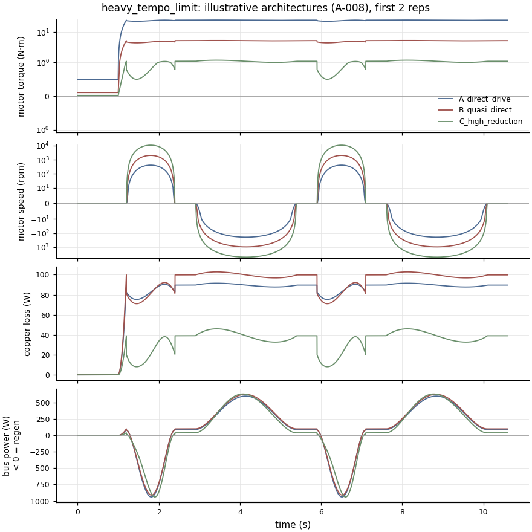

# WP2 drivetrain baseline (illustrative architectures)

> Generated by `make report`. Do not edit by hand. These are abstract simulation inputs and idealised metrics, not certification, not proof of feasibility, and not exercise or human-use guidance.

Input hash: `9d9c6703e2cac208`

What each **illustrative** architecture (A-008) would demand of a motor and power stage for each duty cycle. A rigid lumped model (A-009) with copper loss only (A-010), evaluated at 100 °C. Thermal figures are worst 60 s moving-window values (A-012). No motor is selected, so nothing here says any architecture is feasible.

## Architectures

| Architecture | Ratio | η | Drum radius m | Drum width mm | Inertia at drum kg·m² | Effective cable mass kg | Km@25 °C N·m/√W |
|---|---:|---:|---|---:|---:|---:|---:|
| A_direct_drive: Large low-speed torque motor coupled directly to the drum. | 1 | 0.98 | 0.0220–0.0220 | 80 | 0.0102 | 21 | 3 |
| B_quasi_direct: Outrunner-class BLDC with a single-stage ~6:1 low-backlash reduction. | 6 | 0.95 | 0.0270–0.0270 | 72 | 0.0219 | 30 | 0.6 |
| C_high_reduction: Small fast servo with ~25:1 reduction and a compact multi-layer drum. | 25 | 0.85 | 0.0170–0.0210 | 40 | 0.0751 | 260 | 0.2 |

Bus power excludes drive and PSU losses (A-010). *Buffer at mean draw* is the lossless energy storage that would let the supply deliver only the session-mean power, absorbing regeneration and covering peaks. Without storage, the supply must deliver the peak draw and a dump load must absorb the peak regen.

Effective cable mass is the rotating inertia felt at the cable, J/r², at the smallest radius. The controller must supply extra torque to hide it during fast changes (R-04).

## curl_reference

| Architecture | Peak motor N·m | Worst-window RMS N·m | Peak rpm | Peak copper W | Worst-window copper W | Peak bus draw W | Peak regen W | Regen kJ | Mean bus W | Buffer at mean draw kJ |
|---|---:|---:|---:|---:|---:|---:|---:|---:|---:|---:|
| A_direct_drive | 4.7 | 3.3 | 339 | 3 | 2 | 88 | 140 | 2.5 | 1 | 0.2 |
| B_quasi_direct | 1.0 | 0.7 | 1658 | 4 | 2 | 92 | 140 | 2.5 | 2 | 0.3 |
| C_high_reduction | 0.4 | 0.2 | 8881 | 4 | 1 | 125 | 228 | 2.6 | 4 | 0.5 |

## row_reference

| Architecture | Peak motor N·m | Worst-window RMS N·m | Peak rpm | Peak copper W | Worst-window copper W | Peak bus draw W | Peak regen W | Regen kJ | Mean bus W | Buffer at mean draw kJ |
|---|---:|---:|---:|---:|---:|---:|---:|---:|---:|---:|
| A_direct_drive | 13.1 | 8.8 | 488 | 25 | 11 | 431 | 577 | 11.8 | 6 | 1.5 |
| B_quasi_direct | 2.7 | 1.8 | 2387 | 27 | 12 | 448 | 567 | 11.5 | 9 | 1.8 |
| C_high_reduction | 0.8 | 0.4 | 12789 | 21 | 5 | 555 | 741 | 10.7 | 11 | 2.2 |

## press_reference

| Architecture | Peak motor N·m | Worst-window RMS N·m | Peak rpm | Peak copper W | Worst-window copper W | Peak bus draw W | Peak regen W | Regen kJ | Mean bus W | Buffer at mean draw kJ |
|---|---:|---:|---:|---:|---:|---:|---:|---:|---:|---:|
| A_direct_drive | 16.2 | 9.4 | 570 | 38 | 13 | 630 | 838 | 13.7 | 8 | 1.9 |
| B_quasi_direct | 3.4 | 2.0 | 2785 | 42 | 14 | 655 | 821 | 13.3 | 11 | 2.3 |
| C_high_reduction | 1.0 | 0.4 | 14921 | 30 | 6 | 799 | 1049 | 12.4 | 14 | 2.8 |

## slow_heavy_pull_reference

| Architecture | Peak motor N·m | Worst-window RMS N·m | Peak rpm | Peak copper W | Worst-window copper W | Peak bus draw W | Peak regen W | Regen kJ | Mean bus W | Buffer at mean draw kJ |
|---|---:|---:|---:|---:|---:|---:|---:|---:|---:|---:|
| A_direct_drive | 40.0 | 35.9 | 102 | 231 | 186 | 655 | 197 | 4.0 | 66 | 16.2 |
| B_quasi_direct | 8.5 | 7.4 | 497 | 257 | 198 | 694 | 188 | 3.8 | 72 | 17.6 |
| C_high_reduction | 1.8 | 1.4 | 2664 | 104 | 68 | 591 | 302 | 8.6 | 32 | 8.4 |

## peak_tension_hold_limit

| Architecture | Peak motor N·m | Worst-window RMS N·m | Peak rpm | Peak copper W | Worst-window copper W | Peak bus draw W | Peak regen W | Regen kJ | Mean bus W | Buffer at mean draw kJ |
|---|---:|---:|---:|---:|---:|---:|---:|---:|---:|---:|
| A_direct_drive | 50.2 | 48.5 | 81 | 363 | 339 | 784 | 78 | 0.0 | 339 | 0.9 |
| B_quasi_direct | 10.6 | 10.2 | 398 | 405 | 374 | 838 | 71 | 0.0 | 375 | 1.0 |
| C_high_reduction | 2.3 | 2.1 | 2132 | 171 | 143 | 649 | 273 | 0.4 | 148 | 0.6 |

## heavy_tempo_limit

| Architecture | Peak motor N·m | Worst-window RMS N·m | Peak rpm | Peak copper W | Worst-window copper W | Peak bus draw W | Peak regen W | Regen kJ | Mean bus W | Buffer at mean draw kJ |
|---|---:|---:|---:|---:|---:|---:|---:|---:|---:|---:|
| A_direct_drive | 50.2 | 47.4 | 407 | 362 | 323 | 1380 | 1713 | 4.8 | 334 | 2.0 |
| B_quasi_direct | 10.6 | 9.9 | 1989 | 405 | 350 | 1453 | 1657 | 4.7 | 377 | 2.1 |
| C_high_reduction | 2.3 | 2.0 | 10658 | 170 | 127 | 1337 | 1730 | 5.2 | 212 | 1.8 |

## full_stroke_limit

| Architecture | Peak motor N·m | Worst-window RMS N·m | Peak rpm | Peak copper W | Worst-window copper W | Peak bus draw W | Peak regen W | Regen kJ | Mean bus W | Buffer at mean draw kJ |
|---|---:|---:|---:|---:|---:|---:|---:|---:|---:|---:|
| A_direct_drive | 10.9 | 9.5 | 814 | 17 | 13 | 700 | 816 | 4.2 | 19 | 0.9 |
| B_quasi_direct | 2.4 | 2.0 | 3979 | 20 | 14 | 728 | 801 | 4.1 | 29 | 1.0 |
| C_high_reduction | 0.7 | 0.4 | 25352 | 18 | 6 | 1162 | 1280 | 4.4 | 53 | 1.1 |

## fast_reversal_limit

| Architecture | Peak motor N·m | Worst-window RMS N·m | Peak rpm | Peak copper W | Worst-window copper W | Peak bus draw W | Peak regen W | Regen kJ | Mean bus W | Buffer at mean draw kJ |
|---|---:|---:|---:|---:|---:|---:|---:|---:|---:|---:|
| A_direct_drive | 26.8 | 19.0 | 814 | 103 | 52 | 1917 | 1698 | 6.6 | 68 | 0.5 |
| B_quasi_direct | 6.3 | 4.0 | 3979 | 141 | 58 | 2114 | 1735 | 6.3 | 98 | 0.6 |
| C_high_reduction | 3.3 | 1.6 | 21315 | 354 | 83 | 5099 | 3376 | 10.5 | 314 | 1.2 |

## eccentric_overload_limit

| Architecture | Peak motor N·m | Worst-window RMS N·m | Peak rpm | Peak copper W | Worst-window copper W | Peak bus draw W | Peak regen W | Regen kJ | Mean bus W | Buffer at mean draw kJ |
|---|---:|---:|---:|---:|---:|---:|---:|---:|---:|---:|
| A_direct_drive | 30.0 | 21.9 | 271 | 130 | 69 | 448 | 492 | 6.6 | 47 | 7.9 |
| B_quasi_direct | 6.3 | 4.6 | 1326 | 145 | 76 | 473 | 477 | 6.4 | 52 | 8.7 |
| C_high_reduction | 1.3 | 0.9 | 7105 | 59 | 29 | 425 | 479 | 6.5 | 35 | 5.9 |

## endurance_session_limit

| Architecture | Peak motor N·m | Worst-window RMS N·m | Peak rpm | Peak copper W | Worst-window copper W | Peak bus draw W | Peak regen W | Regen kJ | Mean bus W | Buffer at mean draw kJ |
|---|---:|---:|---:|---:|---:|---:|---:|---:|---:|---:|
| A_direct_drive | 25.4 | 23.4 | 326 | 93 | 79 | 728 | 735 | 52.2 | 47 | 5.5 |
| B_quasi_direct | 5.4 | 4.8 | 1592 | 105 | 85 | 759 | 712 | 50.5 | 55 | 6.3 |
| C_high_reduction | 1.2 | 1.0 | 8526 | 50 | 30 | 788 | 715 | 51.6 | 41 | 4.9 |

## low_force_limit

| Architecture | Peak motor N·m | Worst-window RMS N·m | Peak rpm | Peak copper W | Worst-window copper W | Peak bus draw W | Peak regen W | Regen kJ | Mean bus W | Buffer at mean draw kJ |
|---|---:|---:|---:|---:|---:|---:|---:|---:|---:|---:|
| A_direct_drive | 2.1 | 0.8 | 407 | 1 | 0 | 29 | 60 | 0.4 | 0 | 0.0 |
| B_quasi_direct | 0.5 | 0.2 | 1989 | 1 | 0 | 35 | 71 | 0.4 | 1 | 0.0 |
| C_high_reduction | 0.5 | 0.1 | 10658 | 7 | 1 | 311 | 260 | 1.8 | 6 | 0.4 |

