# WP1 duty cycles

> Generated by `make report`. Do not edit by hand. These are abstract simulation inputs and idealised metrics, not certification, not proof of feasibility, and not exercise or human-use guidance.

Input hash: `df42c1357c3a69fd`

Generated with odrt 0.1.0, Python 3.9.12, NumPy 1.26.4. Sample rate 1000 Hz, tension ramp 0.2 s, rest tension 5 lbf, under-tension threshold 6 lbf.

Power sign: absorbed = device takes energy from the cable (extension); returned = device gives energy back (retraction). RMS tension is a copper-loss proxy only (A-006).

| Scenario | Kind | Duration s | Peak lbf | RMS lbf | Peak ext. m/s | Peak ret. m/s | Peak \|a\| m/s² | Peak absorbed W | Peak returned W | Absorbed kJ | Returned kJ | TUT s | Longest ≥95% peak s |
|---|---|---:|---:|---:|---:|---:|---:|---:|---:|---:|---:|---:|---:|
| [curl_reference](#curl_reference) | reference | 302.6 | 40 | 26 | 0.78 | 0.47 | 2.0 | 139 | 83 | 2.7 | 2.7 | 121 | 40.0 |
| [row_reference](#row_reference) | reference | 494.8 | 120 | 62 | 1.12 | 0.75 | 3.5 | 601 | 400 | 12.8 | 12.8 | 134 | 33.0 |
| [press_reference](#press_reference) | reference | 458.8 | 150 | 69 | 1.31 | 0.87 | 4.0 | 876 | 584 | 14.9 | 14.9 | 98 | 24.0 |
| [slow_heavy_pull_reference](#slow_heavy_pull_reference) | reference | 512.6 | 400 | 217 | 0.23 | 0.23 | 0.2 | 417 | 417 | 13.3 | 13.3 | 151 | 50.0 |
| [peak_tension_hold_limit](#peak_tension_hold_limit) | limit | 41.2 | 500 | 487 | 0.19 | 0.19 | 0.6 | 417 | 417 | 0.7 | 0.7 | 39 | 39.0 |
| [heavy_tempo_limit](#heavy_tempo_limit) | limit | 25.7 | 500 | 479 | 0.94 | 0.45 | 2.4 | 2085 | 1001 | 6.7 | 6.7 | 24 | 23.5 |
| [full_stroke_limit](#full_stroke_limit) | limit | 29.7 | 100 | 96 | 1.88 | 1.50 | 2.9 | 834 | 667 | 4.4 | 4.4 | 28 | 27.5 |
| [fast_reversal_limit](#fast_reversal_limit) | limit | 18.2 | 200 | 188 | 1.88 | 1.88 | 14.4 | 1668 | 1668 | 7.1 | 7.1 | 16 | 16.0 |
| [eccentric_overload_limit](#eccentric_overload_limit) | limit | 359.6 | 300 | 156 | 0.62 | 0.23 | 1.3 | 556 | 313 | 8.0 | 12.0 | 118 | 4.4 |
| [endurance_session_limit](#endurance_session_limit) | limit | 855.6 | 250 | 178 | 0.75 | 0.56 | 1.5 | 834 | 626 | 64.1 | 64.1 | 435 | 54.0 |
| [low_force_limit](#low_force_limit) | limit | 124.4 | 8 | 7 | 0.94 | 0.62 | 2.9 | 33 | 22 | 0.4 | 0.4 | 63 | 31.1 |

## curl_reference

Curl-like short stroke at light tension, slow lowering.

- Requirements: R-03, R-05, R-07
- Assumptions: A-001, A-002, A-003, A-004, A-005
- Stroke 0.5 m from 0.3 m; per rep: extend 1.2 s, top hold 0.3 s, retract 2 s, bottom hold 0.5 s; 10 reps x 3 sets, rest 90 s
- Tension setpoint: 40 lbf extension, 40 lbf retraction

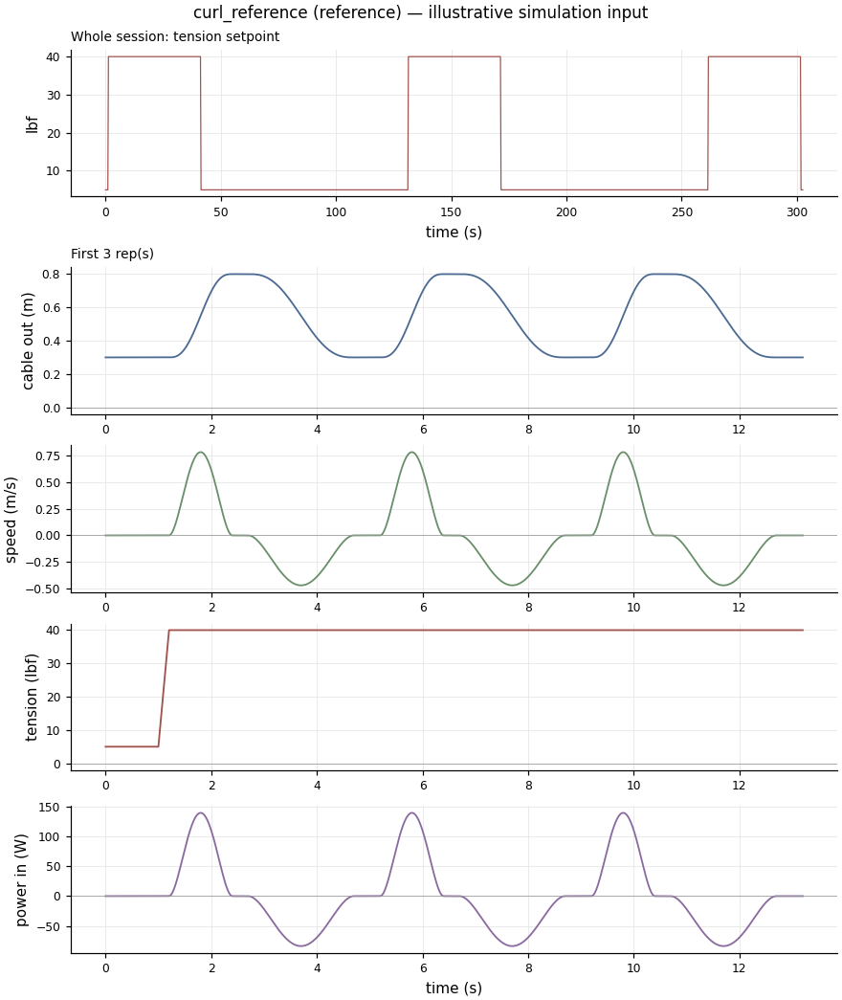

## row_reference

Row-like medium stroke at moderate tension.

- Requirements: R-02, R-05, R-07
- Assumptions: A-001, A-002, A-003, A-004, A-005
- Stroke 0.6 m from 0.4 m; per rep: extend 1 s, top hold 0.5 s, retract 1.5 s, bottom hold 0.3 s; 10 reps x 4 sets, rest 120 s
- Tension setpoint: 120 lbf extension, 120 lbf retraction

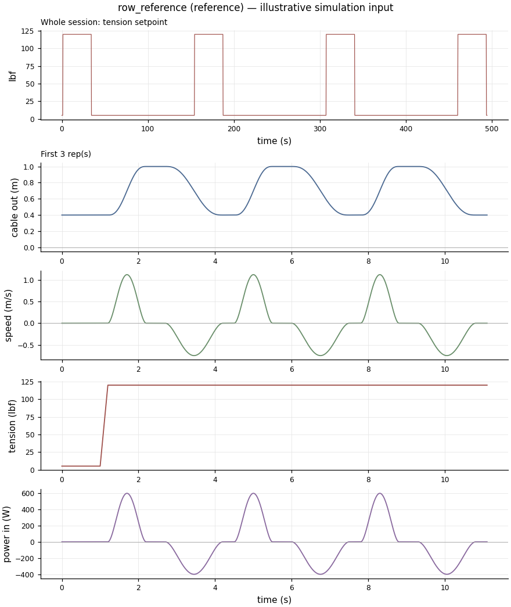

## press_reference

Press-like longer stroke at moderate-to-high tension.

- Requirements: R-02, R-05, R-06, R-07
- Assumptions: A-001, A-002, A-003, A-004, A-005
- Stroke 0.7 m from 0.3 m; per rep: extend 1 s, top hold 0.2 s, retract 1.5 s, bottom hold 0.3 s; 8 reps x 4 sets, rest 120 s
- Tension setpoint: 150 lbf extension, 150 lbf retraction

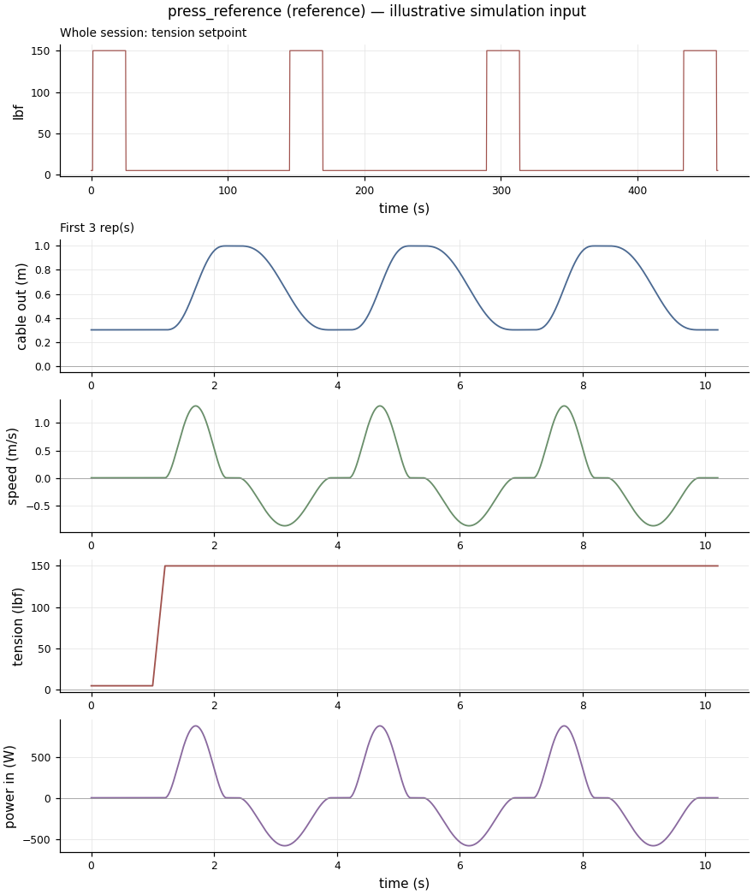

## slow_heavy_pull_reference

Slow heavy pull near the top of the range (~0.23 m/s peak).

- Requirements: R-01, R-02, R-07
- Assumptions: A-001, A-002, A-003, A-004, A-005
- Stroke 0.5 m from 0.2 m; per rep: extend 4 s, top hold 1 s, retract 4 s, bottom hold 1 s; 5 reps x 3 sets, rest 180 s
- Tension setpoint: 400 lbf extension, 400 lbf retraction

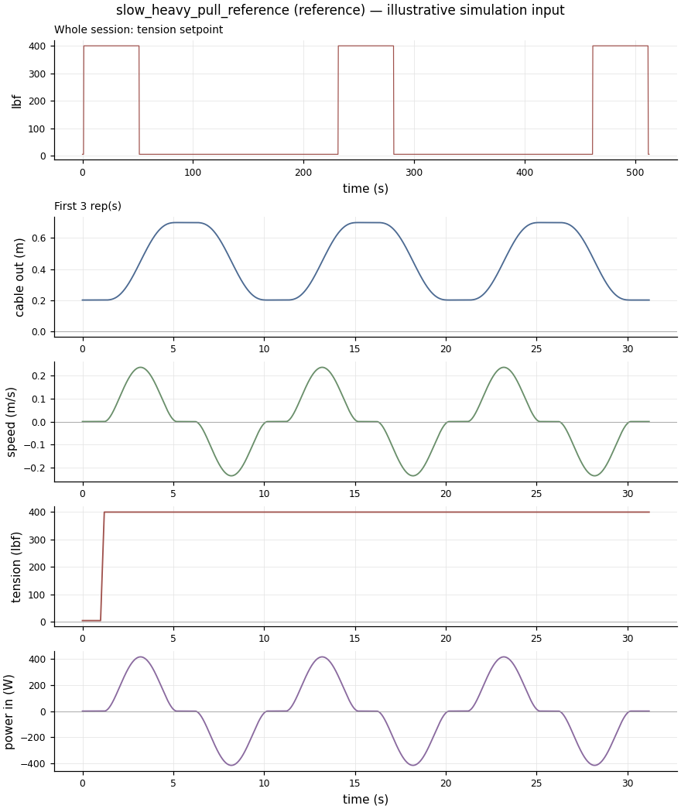

## peak_tension_hold_limit

Short pull then a 10 s hold at the full 500 lbf target. Sizes stall torque and stall heating.

- Requirements: R-01, R-02, R-07
- Assumptions: A-001, A-002, A-003
- Stroke 0.1 m from 0.2 m; per rep: extend 1 s, top hold 10 s, retract 1 s, bottom hold 1 s; 3 reps x 1 sets, rest 0 s
- Tension setpoint: 500 lbf extension, 500 lbf retraction

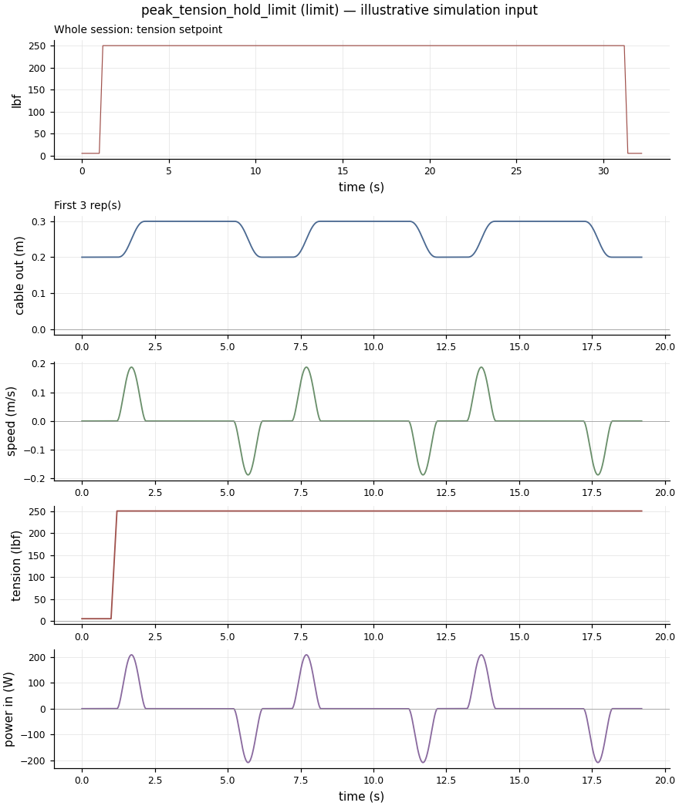

## heavy_tempo_limit

500 lbf at the fast end of heavy-lift tempos (0.94 m/s peak concentric, A-007). Min-jerk fixes peak/mean at 1.875, so the mean (0.5 m/s) is higher than measured 1RM lifts; conservative for power and heat.

- Requirements: R-01, R-02, R-06
- Assumptions: A-001, A-002, A-003, A-007
- Stroke 0.6 m from 0.2 m; per rep: extend 1.2 s, top hold 0.5 s, retract 2.5 s, bottom hold 0.5 s; 5 reps x 1 sets, rest 0 s
- Tension setpoint: 500 lbf extension, 500 lbf retraction

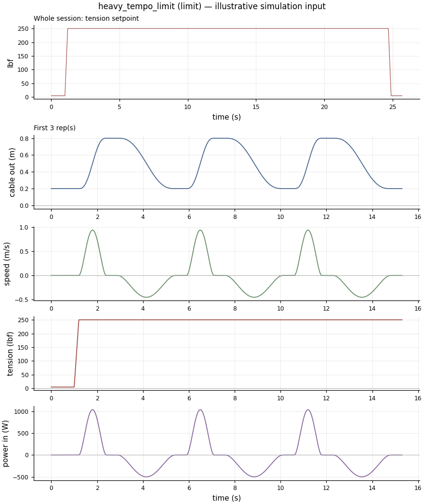

## full_stroke_limit

Full 2.0 m usable stroke from fully wound. Sizes drum capacity and winding-layer range.

- Requirements: R-05
- Assumptions: A-001, A-002, A-003
- Stroke 2 m from 0 m; per rep: extend 2 s, top hold 0.5 s, retract 2.5 s, bottom hold 0.5 s; 5 reps x 1 sets, rest 0 s
- Tension setpoint: 100 lbf extension, 100 lbf retraction

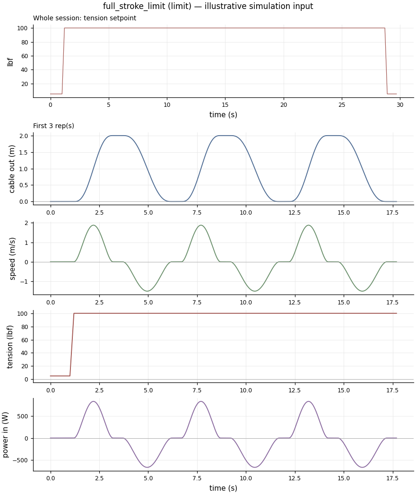

## fast_reversal_limit

Fast back-to-back reversals with no holds (~1.9 m/s, ~14 m/s^2 peak). Stresses direction changes and regeneration.

- Requirements: R-04, R-06
- Assumptions: A-001, A-002, A-003
- Stroke 0.4 m from 0.4 m; per rep: extend 0.4 s, top hold 0 s, retract 0.4 s, bottom hold 0 s; 20 reps x 1 sets, rest 0 s
- Tension setpoint: 200 lbf extension, 200 lbf retraction

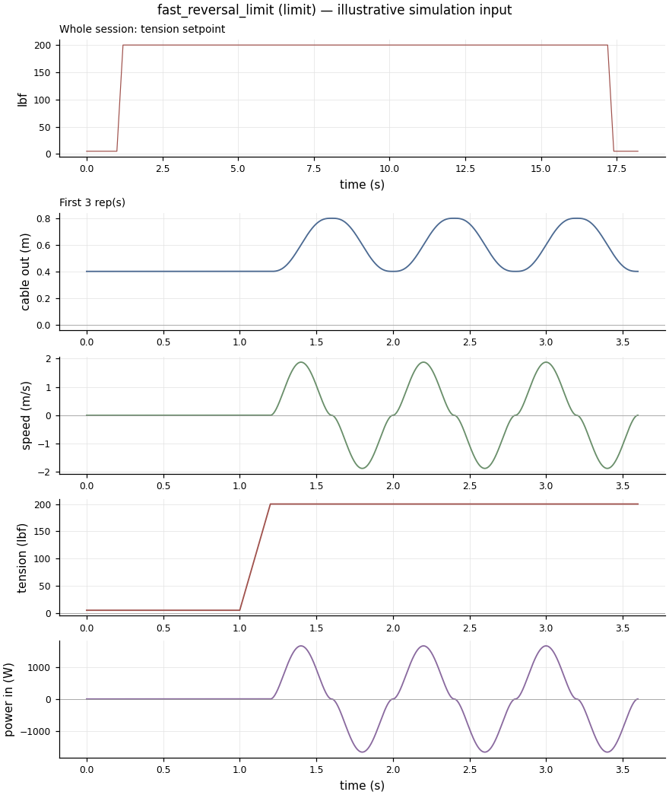

## eccentric_overload_limit

Retraction tension above extension tension, so the device returns more energy than it absorbs.

- Requirements: R-03, R-06
- Assumptions: A-001, A-002, A-003
- Stroke 0.5 m from 0.3 m; per rep: extend 1.5 s, top hold 0.5 s, retract 4 s, bottom hold 0.5 s; 6 reps x 3 sets, rest 120 s
- Tension setpoint: 200 lbf extension, 300 lbf retraction

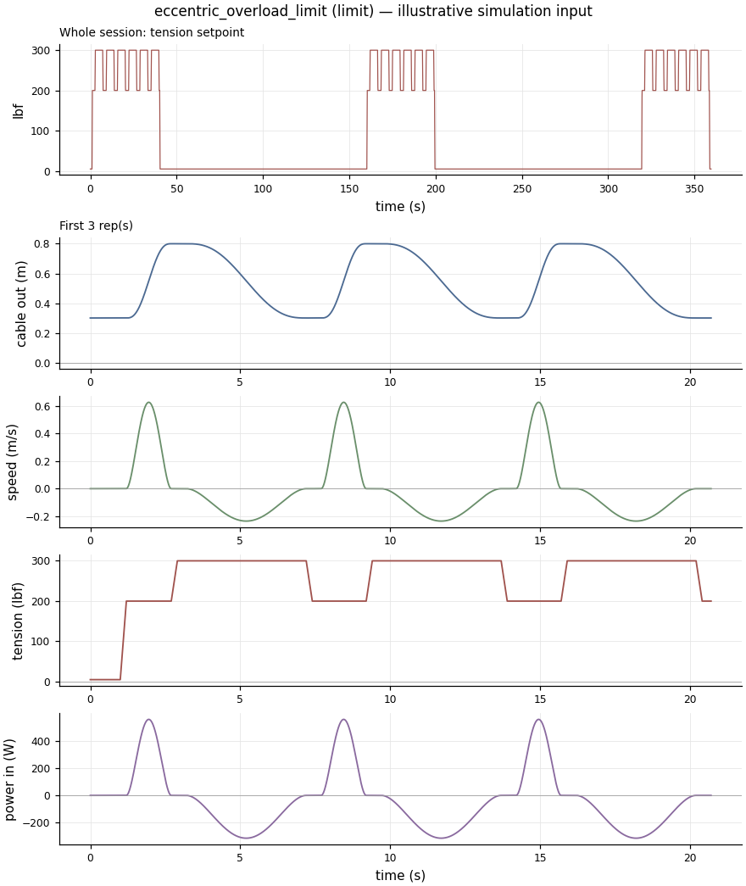

## endurance_session_limit

Long session with short rests at 250 lbf. Drives thermal soak.

- Requirements: R-02, R-07
- Assumptions: A-001, A-002, A-003, A-004
- Stroke 0.6 m from 0.3 m; per rep: extend 1.5 s, top hold 0.5 s, retract 2 s, bottom hold 0.5 s; 12 reps x 8 sets, rest 60 s
- Tension setpoint: 250 lbf extension, 250 lbf retraction

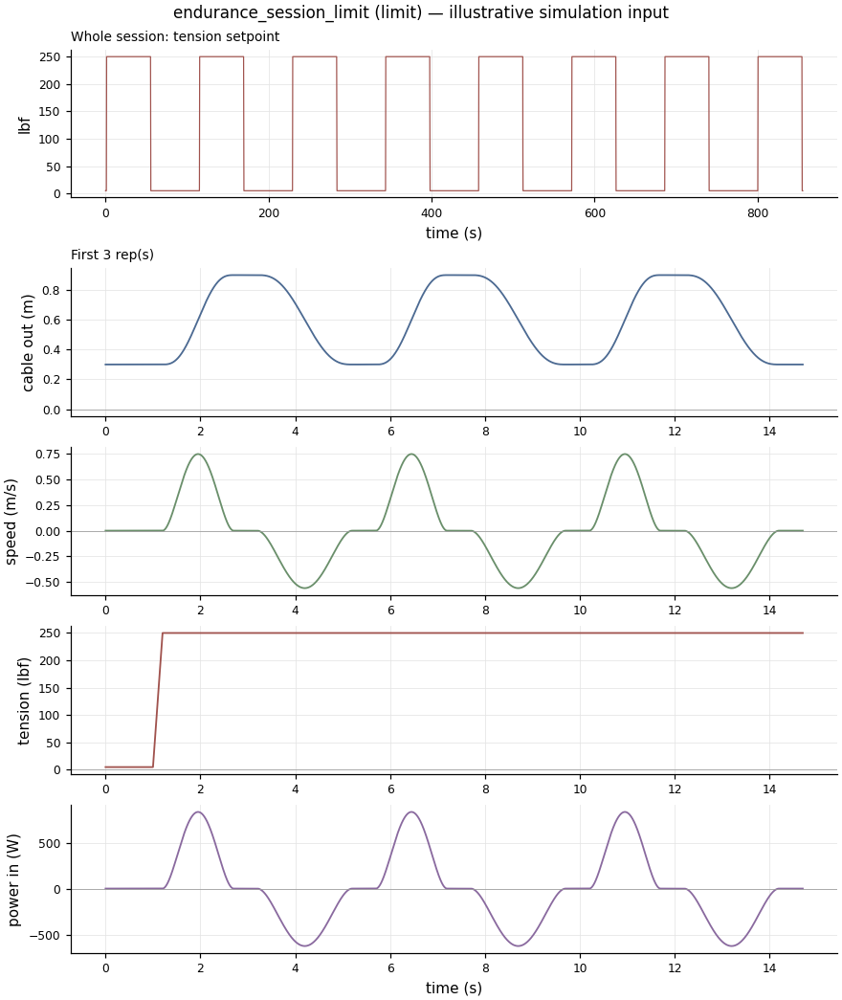

## low_force_limit

Very light tension (8 lbf) for fine low-force control and smoothness questions.

- Requirements: R-03, R-04
- Assumptions: A-001, A-002, A-003, A-004
- Stroke 0.5 m from 0.3 m; per rep: extend 1 s, top hold 0.3 s, retract 1.5 s, bottom hold 0.3 s; 10 reps x 2 sets, rest 60 s
- Tension setpoint: 8 lbf extension, 8 lbf retraction

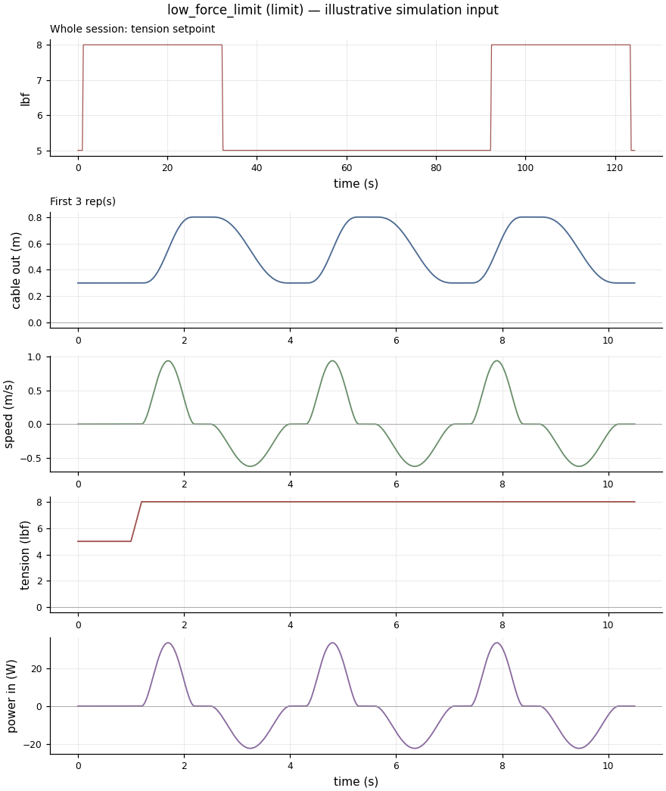
