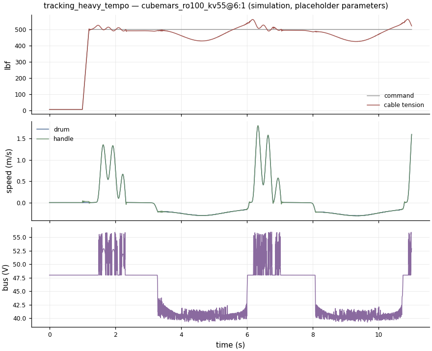
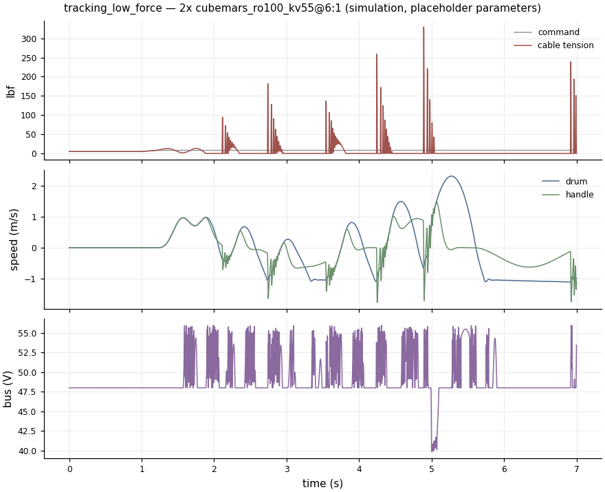
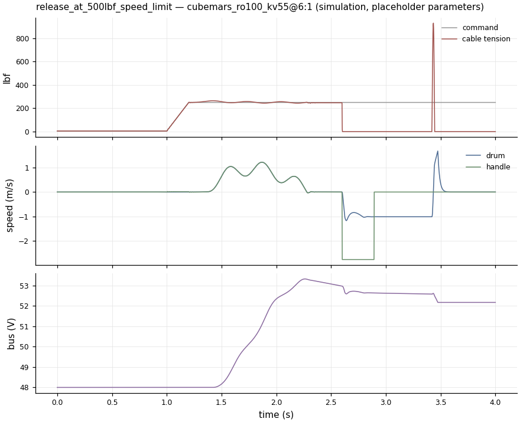
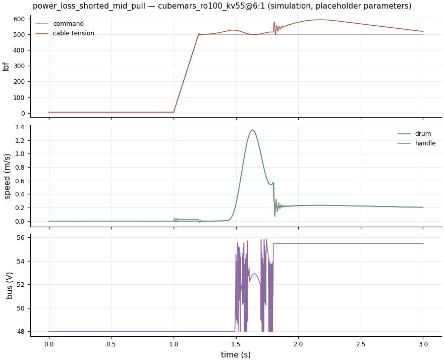

# Dynamic model and fault cases

> Generated by `make report`. Do not edit by hand. These are abstract simulation inputs and idealised metrics, not certification, not proof of feasibility, and not exercise or human-use guidance.

Input hash: `a070e646fd480c55`

Time-domain model: stretchy cable that can go slack, drum with reflected inertia, gear efficiency, friction, a lagging current loop, delayed and noisy sensors, an arm surrogate, a tension controller (feedforward, slow PI, friction and inertia compensation) and the DC bus with a braking resistor. Every parameter is a placeholder (A-016), and every safety value is a proposal for review (A-017). **Simulation only. Nothing here validates a safety function.**

Columns: tracking error is RMS tension error before any fault (after 1 s for fault-free cases), as % of the mean command. *Hand lurch* is the largest gap between the arm surrogate's hand and its planned path after the fault. *End-stop speed* is how fast a released handle hits the device. Overvoltage line 60 V; the drive locks out torque below 40 V; the supply delivers at most 1000 W and cannot absorb regeneration.

## cubemars_ro100_kv55@6:1

| Case | Fault (at s) | Safety layer / independent | Peak tension lbf | Tracking error % | Hand lurch m | End-stop speed m/s | Peak retract m/s | Peak bus V | To overvoltage ms | Min bus V | Release latched | Sensor fault | STO after ms | Monitor tripped |
|---|---|---|---:|---:|---:|---:|---:|---:|---:|---:|---:|---:|---:|---:|
| tracking_heavy_tempo | none | on / on | 534 | 1.6 | — | — | 0.5 | 56 | — | 42 | no | no | — | no |
| tracking_low_force | none | on / on | 11 | 12.4 | — | — | 0.6 | 48 | — | 48 | no | no | — | no |
| tracking_fast_reversal | none | on / on | 311 | 28.9 | — | — | 1.3 | 52 | — | 48 | no | no | — | no |
| release_at_500lbf | handle_release (2.6) | off / on | 7971 | 2.6 | — | 5.5 | 7.8 | 56 | — | 40 | no | no | — | no |
| release_at_500lbf_speed_limit | handle_release (2.6) | on / on | 932 | 2.6 | — | 5.5 | 5.5 | 56 | — | 48 | yes | no | 927 | no |
| load_cell_stuck_zero | load_cell_zero (2.6) | off / on | 612 | 2.6 | 0.25 | — | 0.9 | 56 | — | 46 | no | no | — | no |
| load_cell_stuck_zero_monitored | load_cell_zero (2.6) | on / on | 526 | 2.6 | 0.42 | — | 0.2 | 56 | — | 48 | no | yes | — | yes |
| power_loss_open_mid_pull | power_loss_open (1.8) | on / off | 526 | 3.8 | 1.16 | — | 0.3 | 52 | — | 48 | no | yes | — | yes |
| power_loss_braked_mid_pull | power_loss_braked (1.8) | on / off | 526 | 3.8 | 0.50 | — | 0.0 | 52 | — | 48 | no | no | — | no |
| power_loss_shorted_mid_pull | power_loss_shorted (1.8) | on / off | 592 | 3.8 | 0.21 | — | 0.0 | 52 | — | 48 | no | no | — | no |
| regen_no_dump_resistor | no_dump_resistor (1.2) | on / on | 526 | 2.0 | 0.06 | — | 0.0 | 57 | — | 48 | no | no | — | no |
| regen_with_dump_resistor | none | on / on | 526 | 2.0 | — | — | 0.0 | 56 | — | 48 | no | no | — | no |
| torque_frozen_end_of_set | torque_frozen (22) | on / off | 772 | 1.7 | 1.72 | — | 5.3 | 56 | — | 0 | no | no | — | no |
| torque_frozen_watchdog | torque_frozen (22) | on / on | 534 | 1.7 | 1.11 | — | 6.0 | 56 | — | 42 | no | yes | 50 | yes |
| torque_inverted_mid_pull | torque_inverted (1.8) | on / off | 526 | 3.8 | 1.18 | — | 0.3 | 52 | — | 40 | no | yes | — | yes |
| torque_inverted_sto | torque_inverted (1.8) | on / on | 691 | 3.8 | 0.90 | — | 0.0 | 52 | — | 44 | no | yes | 107 | yes |
| encoder_loss_mid_set | encoder_loss (1.8) | on / on | 543 | 3.8 | 0.13 | — | 0.8 | 56 | — | 40 | no | no | — | no |
| deck_empty_pull | deck_empty (0) | off / on | 590 | 0.0 | — | — | 4.8 | 50 | — | 40 | no | no | — | no |
| deck_empty_pull_presence | deck_empty (0) | on / on | 7 | 0.0 | — | — | 0.4 | 48 | — | 48 | no | no | — | no |

## 2x cubemars_ro100_kv55@6:1

| Case | Fault (at s) | Safety layer / independent | Peak tension lbf | Tracking error % | Hand lurch m | End-stop speed m/s | Peak retract m/s | Peak bus V | To overvoltage ms | Min bus V | Release latched | Sensor fault | STO after ms | Monitor tripped |
|---|---|---|---:|---:|---:|---:|---:|---:|---:|---:|---:|---:|---:|---:|
| tracking_heavy_tempo | none | on / on | 530 | 2.1 | — | — | 0.7 | 56 | — | 45 | no | no | — | no |
| tracking_low_force | none | on / on | 338 | 260.2 | — | — | 1.8 | 52 | — | 46 | no | no | — | no |
| tracking_fast_reversal | none | on / on | 328 | 55.4 | — | — | 1.8 | 54 | — | 47 | no | yes | — | yes |
| release_at_500lbf | handle_release (2.6) | off / on | 7720 | 4.2 | — | 5.5 | 5.5 | 56 | — | 40 | no | no | — | no |
| release_at_500lbf_speed_limit | handle_release (2.6) | on / on | 1322 | 4.2 | — | 5.5 | 5.5 | 56 | — | 48 | yes | no | 911 | yes |
| load_cell_stuck_zero | load_cell_zero (2.6) | off / on | 701 | 4.2 | 0.44 | — | 3.1 | 56 | — | 40 | no | no | — | no |
| load_cell_stuck_zero_monitored | load_cell_zero (2.6) | on / on | 530 | 4.2 | 0.43 | — | 0.3 | 56 | — | 48 | no | yes | — | yes |
| power_loss_open_mid_pull | power_loss_open (1.8) | on / off | 530 | 4.7 | 1.15 | — | 0.3 | 54 | — | 48 | no | yes | — | yes |
| power_loss_braked_mid_pull | power_loss_braked (1.8) | on / off | 530 | 4.7 | 0.53 | — | 0.0 | 54 | — | 48 | no | no | — | no |
| power_loss_shorted_mid_pull | power_loss_shorted (1.8) | on / off | 591 | 4.7 | 0.20 | — | 0.0 | 54 | — | 48 | no | no | — | no |
| regen_no_dump_resistor | no_dump_resistor (1.2) | on / on | 530 | 2.0 | 0.08 | — | 0.4 | 59 | — | 48 | no | no | — | no |
| regen_with_dump_resistor | none | on / on | 530 | 2.9 | — | — | 0.4 | 56 | — | 48 | no | no | — | no |
| torque_frozen_end_of_set | torque_frozen (22) | on / off | 796 | 2.1 | 1.77 | — | 4.2 | 56 | — | 0 | no | no | — | no |
| torque_frozen_watchdog | torque_frozen (22) | on / on | 530 | 2.1 | 1.11 | — | 6.0 | 56 | — | 45 | no | yes | 50 | yes |
| torque_inverted_mid_pull | torque_inverted (1.8) | on / off | 530 | 4.7 | 1.16 | — | 0.3 | 54 | — | 40 | no | yes | — | yes |
| torque_inverted_sto | torque_inverted (1.8) | on / on | 530 | 4.7 | 0.95 | — | 0.0 | 54 | — | 48 | no | yes | 176 | yes |
| encoder_loss_mid_set | encoder_loss (1.8) | on / on | 597 | 4.7 | 0.24 | — | 1.1 | 56 | — | 43 | no | no | — | yes |
| deck_empty_pull | deck_empty (0) | off / on | 586 | 0.0 | — | — | 3.8 | 52 | — | 40 | no | no | — | no |
| deck_empty_pull_presence | deck_empty (0) | on / on | 174 | 0.0 | — | — | 0.5 | 48 | — | 48 | no | no | 1492 | no |

Figures below are for `cubemars_ro100_kv55@6:1`.

