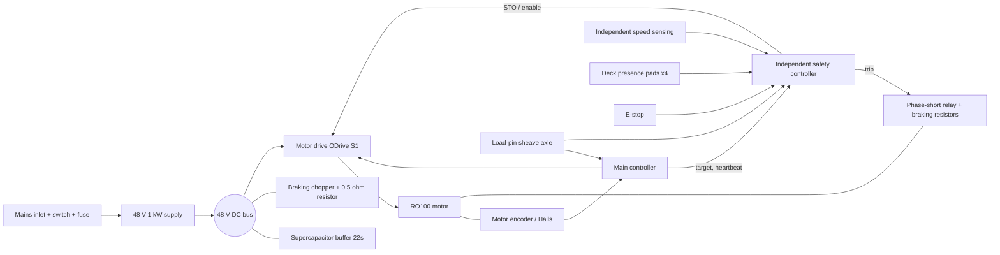

# Electronics and packaging (first pass)

> Generated by `make report`. Do not edit by hand. These are abstract simulation inputs and idealised metrics, not certification, not proof of feasibility, and not exercise or human-use guidance.

Input hash: `e0df107baa166334`

Electrical architecture, heat and current budget for the lead design, and placement of the parts inside the floor platform (A-024). Part envelopes are cited where a source was found and estimated otherwise (see the basis column).

## Architecture

## Parts

| Part | Role | Qty | Envelope mm | Basis | Notes |
|---|---|---:|---|---|---|
| Mean Well RSP-1000-48 | AC-DC supply 48 V 1 kW | 1 | 295 × 127 × 41 | cited (listings disagree; check the official drawing) [source](https://openelab.io/products/meanwell-rsp1000-48-switching-power) | ~90% efficiency (distributors); built-in fan; operating -20 to 60 C with derating |
| ODrive S1 | motor drive (FOC) | 1 | 66 × 50 × 20 | cited footprint; height estimated [source](https://docs.odriverobotics.com/v/latest/hardware/odrive-comparison.html) | 40 A continuous with heat spreader; 80 A peak |
| ODrive heatsink + 60 mm fan | drive cooling | 1 | 70 × 70 × 25 | cited [source](https://odriverobotics.com/shop/heatsink-and-fan-for-odrive-pro) | fan needs a separate 12 V supply |
| Wurth 850617022002 50 F 2.7 V | buffer cell (small-format reference) | 22 | 18 × 18 × 40 | cited (diameter x diameter x height) [source](https://it.rs-online.com/web/p/supercondensatori/1855127) | ESR 20 mohm; -40 to 65 C; used to show why small cells do not work |
| large-format 2.7 V cell (~350 F class) | buffer cell (proposed) | 22 | 35 × 35 × 62 | estimated envelope (not a cited part)  | target ESR <= 5 mohm per cell; select and cite a real part |
| Phidgets 3140_0 500 kg S-type | tension sensing at the sheave hanger | 1 | 75 × 25 × 65 | estimated envelope (dimensions not found) [source](https://www.robotshop.com/products/phidgets-steel-s-type-load-cell-500kg-c3) | 750 kg max overload; -20 to 55 C |
| aluminium-housed braking resistor 0.5 ohm | regeneration dump | 1 | 165 × 60 × 30 | estimated envelope  | power rating to be sized from dump energy |
| independent safety controller board | watchdog + wrong-sign check + STO | 1 | 80 × 60 × 20 | estimated envelope  | needs its own encoder input and tension input (H-06) |
| phase-short relay with braking resistors | STO / power-loss braking | 1 | 75 × 45 × 40 | estimated envelope  | normally closed; contact rating to be sized |
| deck presence load pad | deck occupancy sensing (H-14) | 4 | 40 × 40 × 8 | estimated envelope  | between deck and stringers |
| 80 mm 12 V fan | compartment exhaust | 1 | 80 × 80 × 25 | estimated envelope  | sized from the compartment heat budget |
| IEC C20 inlet + switch + fuse module | mains entry | 1 | 80 × 50 × 45 | estimated envelope  | 16 A class inlet for a 1 kW supply |
| emergency stop button (mushroom) | user stop | 1 | 40 × 40 × 60 | estimated envelope  | wired into the independent STO chain |

## Current and heat budget

| Quantity | Value | Note |
|---|---:|---|
| Motor current, peak / RMS over a heavy set | 53 / 49 A | drive rated 40 A continuous: over rating = **yes** (needs heatsink + fan) |
| DC bus peak current | 33 A | |
| Conductors at 6 A/mm² | phase AWG 8, bus AWG 9 | rule of thumb |
| Buffer RMS current over a heavy set | 17 A | |
| Buffer from cited 50 F cells (22 s) | 2.27 F, 0.44 Ω → 126 W loss, 14 V sag | **unworkable** |
| Buffer from large ≤ 4 mΩ cells (22 s) | 0.09 Ω → 25 W loss, 2.9 V sag | cells not yet selected |
| Heat in the platform, heavy set (motor copper + supply + drive + buffer) | 546 W | |
| Heat in the platform, session average | 89 W | |
| Compartment air, session average: sealed / with fan | 40 / 29 °C | limits: psu 60 °C, capacitors 65 °C, load_cell 55 °C |

## Packaging

Electronics bay between the mechanism and the sheave cross-beam: y = 149 to 400 mm, under the deck and clear of a ±45 mm rope keep-out. Power cables run in a tray level above the buffer and below the rope. Intake slots are in the left skirt; an 80 mm exhaust fan sits in the right skirt above the supply, with the braking resistor in its air path. Tension is measured by a load-pin sheave axle (no room for an S-type cell under a 200 mm deck). **Interferences: 0.**

GLBs (from `make cad`): `build/cad/odrt500_platform_full.glb`, `_cutaway.glb` (deck and right skirt removed), `_exploded.glb`.

Not done: mains safety (creepage, clearance, earthing), EMC, real part selection for the estimated envelopes, harness connectors, service access.
