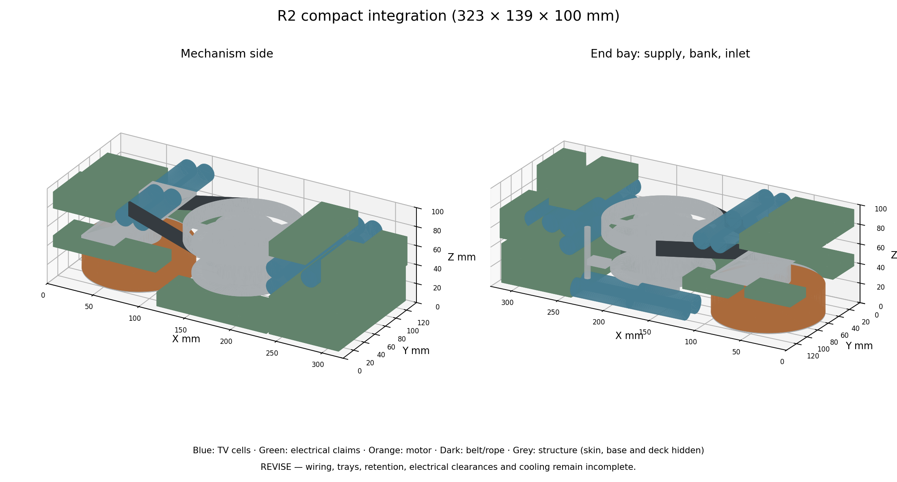

# R2 compact integration

Fingerprint: `0828fc640249d7f531e247ba7c0ea307251054a12fdf3444d5e5468a63ea3e8b`

**REVISE. Space claim, not a qualified assembly.** R2 combines the [support revision](support_revision.md) and [power revision](revision_power.md): 5:1 belt (24/120 × 3 mm), opposed NJ 202 motor bearings in a wall-attached bridge, NU205/NUP205 drum bearings inside the winding core on a 25 mm shaft supported by a base boss and a wall-attached deck, side (+Y) rope exit, EPP-500-54 flat in the end bay, 20 TV cells in three groups, ODrive Pro and Regen Clamp on the deck.

Body target [323, 139, 100] mm; 56 parts; out of bounds: none; unintended solid overlaps: 0.

Drum-referred inertia: 0.016331 kg m² total at 5:1 (drum + wheel 0.000383; motor-side additions 0.000109 at motor speed; catalog rotor included once). Aluminium/steel densities 2700/7850 kg/m³ assumed.

Open-belt length 464.5 mm; pinion wrap 133.0°. Nominal routing 0.062 m: Takeoff tangent at about 37 mm pack radius to guide (~50 mm) plus guide to +Y body exit (~12 mm). Guide contact curvature and exit motion unresolved.

## Collision evidence

No unintended solid overlaps.

rope_path: no listed solid intersection; contact design unqualified.

guide_sweep: no listed solid intersection; contact design unqualified.

## Fidelity

| Part | Evidence/detail |
|---|---|
| base | Proposed structural base; mounting joints unqualified |
| enclosure_skin | 2 mm skin; +Y rope slot and +X inlet/fan openings; sealing and attachment unresolved |
| motor_pedestal | Carrier interface; stator attachment unresolved |
| motor_envelope | Sourced RO100 outer envelope only |
| motor_rotor_adapter | Proposed rotating carrier; motor mating geometry unresolved |
| motor_spindle | Proposed 15 mm spindle; pinion key/clamp unresolved |
| motor_bearing_0 | SKF NJ 202 ECP boundary envelope; opposed NJ pair, axial location unresolved |
| motor_bearing_1 | SKF NJ 202 ECP boundary envelope; opposed NJ pair, axial location unresolved |
| motor_bearing_carrier | Side-wall-attached bridge with bearing housing; wall joints and stiffness unqualified |
| pinion | 24-tooth 3 mm pitch envelope; tooth rating absent |
| drum_base_boss | Lower shaft support; base flange/fastening unqualified |
| drum_dead_shaft | Two-ended 25 mm dead shaft; retention and fits unresolved |
| drum_shaft_spacer_lower | Locates lower bearing inner race; proposal |
| drum_shaft_spacer_upper | Locates upper bearing inner race; proposal |
| drum_bearing_0 | NSK NU205EM boundary envelope; outer race rotates with drum |
| drum_bearing_1 | NSK NUP205EM boundary envelope; outer race rotates with drum |
| drum | Thin-wall core around bearings; 2 mm flanges and hub need load/fatigue review |
| wound_rope_envelope | Occupied winding space only; crossovers and helix absent |
| driven_wheel | 120-tooth envelope with six-spoke web; tooth geometry/rating absent |
| belt_span_-1 | Straight belt envelope; wrap arcs omitted |
| belt_span_1 | Straight belt envelope; wrap arcs omitted |
| deck | Side-wall-attached deck: upper shaft support and electronics tray; plate/joint checks open |
| guide_carriage | Mid-travel; full sweep checked separately |
| guide_screw | Proposed guide drive; synchronization and wear unqualified |
| supply_envelope | Sourced EPP-500-54 envelope; terminals, clearances and 25 CFM path not established |
| capacitor_00 | Eaton TV1860-3R0107-R body (under_drum group); leads, insulation and balance boards additional |
| capacitor_01 | Eaton TV1860-3R0107-R body (under_drum group); leads, insulation and balance boards additional |
| capacitor_02 | Eaton TV1860-3R0107-R body (under_drum group); leads, insulation and balance boards additional |
| capacitor_03 | Eaton TV1860-3R0107-R body (under_drum group); leads, insulation and balance boards additional |
| capacitor_04 | Eaton TV1860-3R0107-R body (end_bay group); leads, insulation and balance boards additional |
| capacitor_05 | Eaton TV1860-3R0107-R body (end_bay group); leads, insulation and balance boards additional |
| capacitor_06 | Eaton TV1860-3R0107-R body (end_bay group); leads, insulation and balance boards additional |
| capacitor_07 | Eaton TV1860-3R0107-R body (end_bay group); leads, insulation and balance boards additional |
| capacitor_08 | Eaton TV1860-3R0107-R body (end_bay group); leads, insulation and balance boards additional |
| capacitor_09 | Eaton TV1860-3R0107-R body (end_bay group); leads, insulation and balance boards additional |
| capacitor_10 | Eaton TV1860-3R0107-R body (end_bay group); leads, insulation and balance boards additional |
| capacitor_11 | Eaton TV1860-3R0107-R body (end_bay group); leads, insulation and balance boards additional |
| capacitor_12 | Eaton TV1860-3R0107-R body (end_bay group); leads, insulation and balance boards additional |
| capacitor_13 | Eaton TV1860-3R0107-R body (end_bay group); leads, insulation and balance boards additional |
| capacitor_14 | Eaton TV1860-3R0107-R body (end_bay group); leads, insulation and balance boards additional |
| capacitor_15 | Eaton TV1860-3R0107-R body (end_bay group); leads, insulation and balance boards additional |
| capacitor_16 | Eaton TV1860-3R0107-R body (over_motor group); leads, insulation and balance boards additional |
| capacitor_17 | Eaton TV1860-3R0107-R body (over_motor group); leads, insulation and balance boards additional |
| capacitor_18 | Eaton TV1860-3R0107-R body (over_motor group); leads, insulation and balance boards additional |
| capacitor_19 | Eaton TV1860-3R0107-R body (over_motor group); leads, insulation and balance boards additional |
| drive_board_pro | Unselected functional allocation; electrical/thermal clearances require verification |
| regen_clamp_board | Unselected functional allocation; electrical/thermal clearances require verification |
| dump_resistor_claim | Unselected functional allocation; electrical/thermal clearances require verification |
| phase_brake_claim | Unselected functional allocation; electrical/thermal clearances require verification |
| application_controller | Unselected functional allocation; electrical/thermal clearances require verification |
| independent_supervisor | Unselected functional allocation; electrical/thermal clearances require verification |
| auxiliary_power_claim | Unselected functional allocation; electrical/thermal clearances require verification |
| transfer_and_bus_claim | Unselected functional allocation; electrical/thermal clearances require verification |
| protection_and_balance | Unselected functional allocation; electrical/thermal clearances require verification |
| mains_entry_and_filter | Unselected functional allocation; electrical/thermal clearances require verification |
| fan_and_duct_claim | Unselected functional allocation; electrical/thermal clearances require verification |

## Remaining requirements

- The bank is split into three groups (8 + 12 wiring lengths unresolved); cell leads, balance taps and insulation are additional.
- Motor bridge and deck are proposed side-wall-attached plates; wall stiffness, joints and fasteners are unqualified.
- Electronics above the deck and in the motor bay sit on proposed trays/standoffs that are not modelled.
- Fan and mains-inlet openings are cut in the +X end wall; airflow path across the supply is not demonstrated.
- Pulleys are smooth pitch envelopes; tooth geometry, belt rating and tensioner are not designed.

Not yet represented: force transducer and overload path, stop actuator, mount retention and sensing, external peer connector, encoder and winding sensor detail, positive shaft/bearing retention, connector bodies and pinouts, mains/DC insulation and airflow keepouts, wiring, bus bars and cell leads, electronics trays and standoffs, belt tensioner.

Reproduce: `make r2-package`. STEP/GLB: `build/cad/r2_integration.step`, `r2_integration_{full,cutaway}.glb`.
